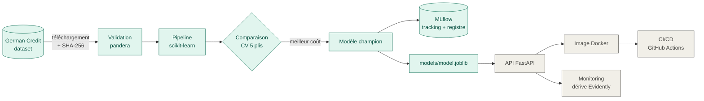
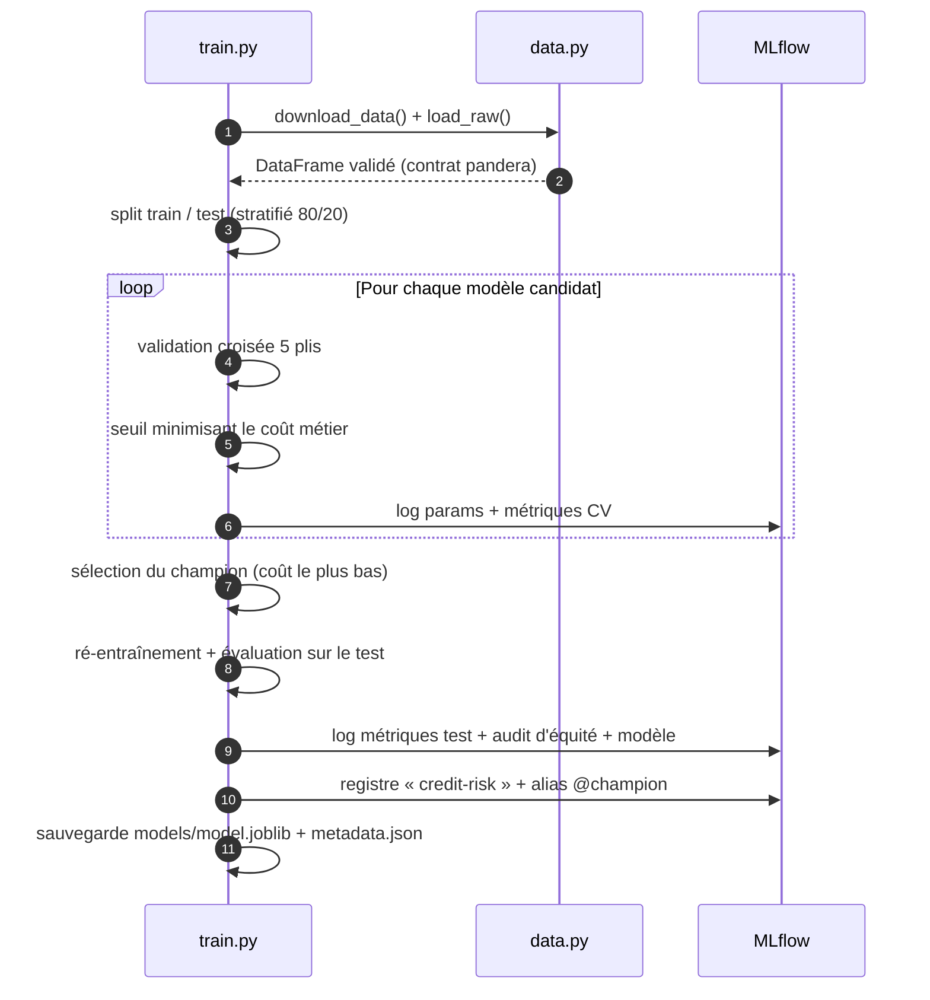

# 🏦 MLOps Credit Risk — scoring de crédit de bout en bout

> Prédire le risque de défaut de paiement d'une demande de crédit, **et surtout
> industrialiser ce modèle** : données validées, expériences tracées, modèle
> versionné, API, conteneur, CI/CD et surveillance de la dérive.


---

## 🎯 Le problème métier

Une banque reçoit des demandes de crédit. Deux erreurs sont possibles :

| Erreur | Conséquence | Coût relatif |
|---|---|---|
| Accorder un crédit à quelqu'un qui ne remboursera pas (**faux négatif**) | Perte du capital prêté | **5** |
| Refuser un bon client (**faux positif**) | Manque à gagner | **1** |

Le modèle n'est donc **pas optimisé pour la précision brute**, mais pour
**minimiser le coût métier** : le seuil de décision est choisi automatiquement
en fonction de cette matrice de coût.

## 🏗️ Architecture



*En vert : réalisé. En gris : prochaines étapes (voir [Feuille de route](#️-feuille-de-route)).*

### Cycle d'entraînement



## 🧰 Stack technique

| Domaine | Outil | Rôle dans le projet |
|---|---|---|
| Langage | **Python 3.11+** | Tout le projet |
| Données | **pandas** | Manipulation des données tabulaires |
| Qualité des données | **pandera** | Contrat de données : types, catégories, bornes |
| Machine Learning | **scikit-learn** | Pipeline de prétraitement, régression logistique, forêt aléatoire, validation croisée |
| Machine Learning | **LightGBM** | Gradient boosting (modèle candidat) |
| MLOps | **MLflow** | Suivi des expériences, registre de modèles, alias `@champion` |
| Tests | **pytest** | Tests unitaires (données, coût, pipeline, équité) |
| Qualité du code | **Ruff** | Linter + formateur (style, bugs, sécurité) |
| Automatisation | **Make** | Commandes raccourcies (`make train`, `make test`…) |
| *À venir* | FastAPI, Docker, GitHub Actions, Evidently | API, conteneur, CI/CD, monitoring |

## 📊 Résultats

Comparaison par **validation croisée à 5 plis** sur le jeu d'entraînement :

| Modèle | ROC-AUC (CV) | Coût métier moyen ↓ | Seuil optimal |
|---|---|---|---|
| **Régression logistique** ✅ | 0.764 | **0.502** | 0.29 |
| Forêt aléatoire | 0.791 | 0.510 | 0.40 |
| LightGBM | 0.784 | 0.534 | 0.14 |

Performance du champion sur le **jeu de test** (200 demandes jamais vues) :

| ROC-AUC | Rappel (défauts détectés) | Précision | Coût métier |
|---|---|---|---|
| 0.810 | **88 %** | 40 % | 0.575 |

**Lecture :** le modèle le plus simple gagne. Avec seulement 1 000 exemples, la
régression logistique généralise mieux et reste **interprétable**, un atout
réglementaire dans le secteur bancaire. Le seuil bas (0.29) traduit la
prudence imposée par la matrice de coût : on détecte 88 % des défauts, au prix
de refuser davantage de bons clients.

## ⚖️ IA responsable

- Les variables **sexe / situation familiale** et **nationalité** sont
  **exclues du modèle** (`config.SENSITIVE_FEATURES`). Un test unitaire le garantit.
- Elles sont conservées pour un **audit d'équité** enregistré dans MLflow à
  chaque entraînement : taux de refus et rappel par groupe.

| Groupe | Effectif (test) | Taux de refus | Rappel |
|---|---|---|---|
| Femmes | 61 | 69 % | 95 % |
| Hommes | 139 | 66 % | 85 % |

Écart de taux de refus faible (≈ 3 points). Le groupe « non étranger » ne
compte que 6 personnes dans le test : trop peu pour conclure, ce qui est
documenté plutôt que masqué.

## 📁 Structure du projet

```
mlops-credit-risk/
├── src/credit_risk/
│   ├── config.py      # chemins, colonnes, variables sensibles
│   ├── schema.py      # contrat de données pandera
│   ├── data.py        # téléchargement (SHA-256), validation, découpage
│   ├── features.py    # pipeline de prétraitement scikit-learn
│   ├── evaluate.py    # métriques, coût métier, seuil optimal, audit d'équité
│   └── train.py       # comparaison de modèles + MLflow + registre
├── tests/             # tests unitaires pytest
├── pyproject.toml     # dépendances et configuration des outils
├── Makefile           # raccourcis de commandes
└── README.md
```

## 🚀 Démarrage rapide

Prérequis : Python 3.11+, `make` et Git (Linux, macOS ou WSL sous Windows).

```bash
git clone https://github.com/Marshall006/mlops-credit-risk.git
cd mlops-credit-risk

make install    # crée l'environnement virtuel .venv et installe les dépendances
make data       # télécharge et valide les données
make test       # lance les tests
make train      # compare les modèles et enregistre le champion dans MLflow
make mlflow-ui  # interface MLflow sur http://localhost:5000
```

## 🗺️ Feuille de route

- [x] Données : téléchargement vérifié et contrat de données
- [x] Entraînement : comparaison de modèles, seuil métier, MLflow, registre
- [x] Audit d'équité
- [ ] API de prédiction FastAPI
- [ ] Conteneurisation Docker + docker-compose (API + MLflow)
- [ ] CI/CD GitHub Actions (lint, tests, entraînement, image sur GHCR)
- [ ] Monitoring de la dérive des données (Evidently)

## 📚 Données

[German Credit Dataset](https://archive.ics.uci.edu/dataset/144/statlog+german+credit+data)
(UCI Machine Learning Repository) : 1 000 demandes de crédit, 20 variables,
30 % de défauts. Matrice de coût 5:1 fournie avec le jeu de données.

## 👤 Auteur

**Soumaïla Cissé Piénikoua IDANI** — [GitHub @Marshall006](https://github.com/Marshall006)
