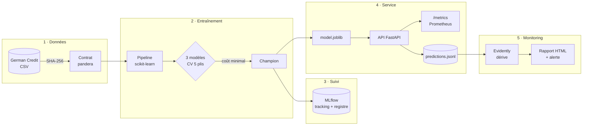
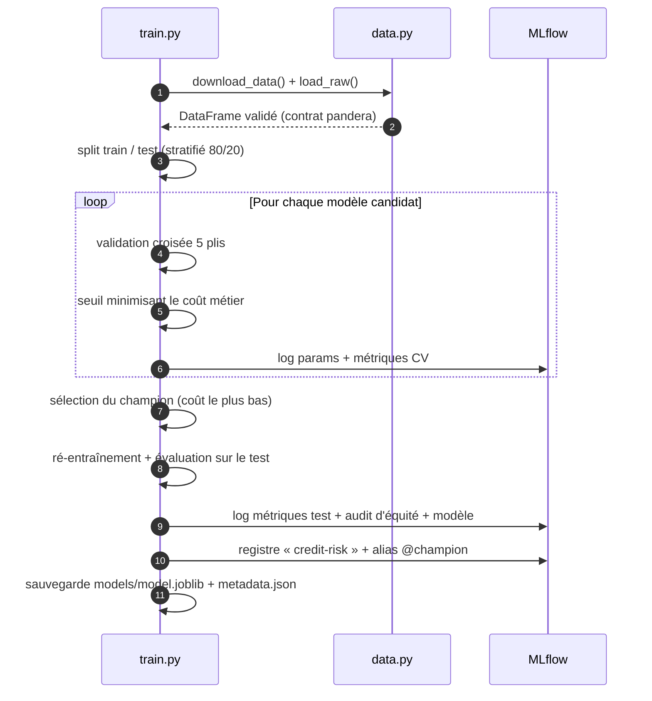
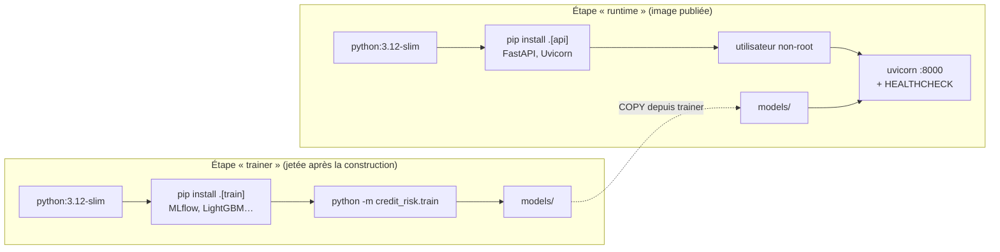
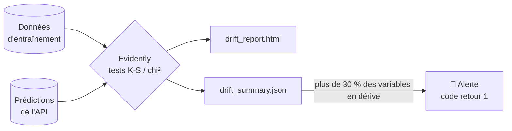
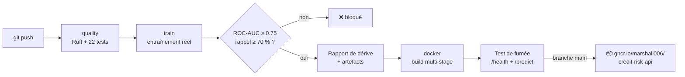

# 🏦 MLOps Credit Risk — scoring de crédit de bout en bout

[](https://github.com/Marshall006/mlops-credit-risk/actions/workflows/ci.yml)


> Un modèle de Machine Learning qui prédit le risque de défaut de paiement d'une
> demande de crédit, **industrialisé de bout en bout** : données sous contrat,
> expériences tracées, modèle versionné, API REST, conteneur Docker, CI/CD et
> surveillance de la dérive des données.

**Compétences démontrées :** Machine Learning (classification, validation
croisée, optimisation d'un seuil métier) · MLOps (MLflow, registre de
modèles, monitoring) · Ingénierie logicielle (API, tests, qualité de code) ·
DevOps (Docker multi-stage, CI/CD, registre d'images) · IA responsable (audit
d'équité).

---

## Sommaire

1. [Le problème métier](#-le-problème-métier)
2. [Architecture](#️-architecture)
3. [Stack technique détaillée](#-stack-technique-détaillée)
4. [Résultats](#-résultats)
5. [IA responsable](#️-ia-responsable)
6. [L'API](#-lapi)
7. [Monitoring de la dérive](#-monitoring-de-la-dérive)
8. [CI/CD](#-cicd)
9. [Démarrage rapide](#-démarrage-rapide)
10. [Structure du projet](#-structure-du-projet)
11. [Choix techniques](#-choix-techniques)

---

## 🎯 Le problème métier

Une banque reçoit des demandes de crédit. Deux erreurs sont possibles :

| Erreur | Conséquence | Coût relatif |
|---|---|---|
| Accorder un crédit à quelqu'un qui ne remboursera pas (**faux négatif**) | Perte du capital prêté | **5** |
| Refuser un bon client (**faux positif**) | Manque à gagner | **1** |

Le modèle n'est donc **pas optimisé pour la précision brute** : le seuil de
décision est choisi automatiquement pour **minimiser le coût métier**.

## 🏗️ Architecture

### Vue d'ensemble



### Cycle d'entraînement



### Image Docker multi-stage



## 🧰 Stack technique détaillée

| Catégorie | Technologie | Version | Rôle dans le projet | Pourquoi ce choix |
|---|---|---|---|---|
| **Langage** | Python | 3.12 | Tout le projet | Standard de l'industrie en data et IA |
| **Données** | pandas | 2.x | Manipulation des données tabulaires | Référence pour les tableaux en Python |
| **Qualité des données** | pandera | ≥ 0.20 | Contrat de données : types, catégories autorisées, bornes, colonnes strictes | Arrête le pipeline si la source change, au lieu d'entraîner sur de mauvaises données |
| **Intégrité** | SHA-256 (hashlib) | — | Vérifie que le fichier téléchargé n'a pas été modifié | Reproductibilité et sécurité de la chaîne de données |
| **Machine Learning** | scikit-learn | ≥ 1.5 | `Pipeline`, `ColumnTransformer`, `StandardScaler`, `OneHotEncoder`, régression logistique, forêt aléatoire, `StratifiedKFold` | API unifiée ; le pipeline évite les écarts entre entraînement et production |
| **Machine Learning** | LightGBM | ≥ 4.5 | Gradient boosting, modèle candidat | Très performant sur données tabulaires |
| **Suivi d'expériences** | MLflow Tracking | 3.x | Paramètres, métriques, artefacts (comparaison, audit d'équité) de chaque run | Traçabilité : qui a entraîné quoi, avec quels réglages |
| **Registre de modèles** | MLflow Model Registry | 3.x | Versions du modèle + alias `@champion` | Changer de modèle en production sans modifier le code |
| **Sérialisation** | joblib | ≥ 1.4 | Sauvegarde du pipeline entraîné (`model.joblib`) | Format natif scikit-learn |
| **API** | FastAPI | ≥ 0.115 | Endpoints REST `/predict`, `/predict/batch`, `/health`, `/model/info` | Rapide, validation automatique, documentation Swagger générée |
| **Validation des requêtes** | Pydantic | 2.x | Schéma des demandes (types, bornes, valeurs autorisées) → erreur 422 sinon | Aucune donnée invalide n'atteint le modèle |
| **Serveur** | Uvicorn | ≥ 0.30 | Serveur ASGI qui exécute l'API | Serveur de référence pour FastAPI |
| **Observabilité** | Prometheus (instrumentator) | ≥ 7.0 | Endpoint `/metrics` : nombre de requêtes, latence, codes HTTP | Prêt à être branché sur Prometheus + Grafana |
| **Monitoring ML** | Evidently | 0.7 | Détection de la dérive des données (tests K-S, chi²) + rapport HTML | Détecte quand le modèle devient obsolète |
| **Conteneurisation** | Docker | — | Image multi-stage, utilisateur non-root, `HEALTHCHECK` | « Ça marche sur ma machine » → partout |
| **Orchestration locale** | Docker Compose | v2 | Serveur MLflow + API + entraînement à la demande | Tout l'environnement en une commande |
| **Registre d'images** | GitHub Container Registry (GHCR) | — | Publication de l'image `credit-risk-api` | Intégré à GitHub, gratuit pour les dépôts publics |
| **CI/CD** | GitHub Actions | — | Lint → tests → entraînement → contrôle qualité → image → test de fumée → publication | Automatisation à chaque push |
| **Tests** | pytest | ≥ 8 | 22 tests : données, coût métier, pipeline, équité, API, dérive | Filet de sécurité avant chaque déploiement |
| **Tests API** | httpx / TestClient | — | Appels HTTP simulés sur l'API | Tester l'API sans lancer de serveur |
| **Qualité du code** | Ruff | ≥ 0.6 | Linter + formateur (style, bugs, sécurité `S`) | Remplace flake8, isort et black, en beaucoup plus rapide |
| **Automatisation** | Make | — | Raccourcis (`make train`, `make api`, `make up`…) | Commandes identiques pour tous |
| **Packaging** | pyproject.toml (PEP 621) | — | Dépendances par usage : `train`, `api`, `monitor`, `dev` | L'image de l'API n'embarque pas MLflow ni Evidently |

## 📊 Résultats

Comparaison par **validation croisée à 5 plis** (jeu d'entraînement, 800 demandes) :

| Modèle | ROC-AUC (CV) | Coût métier moyen ↓ | Seuil optimal |
|---|---|---|---|
| **Régression logistique** ✅ | 0.764 | **0.502** | 0.29 |
| Forêt aléatoire | 0.791 | 0.510 | 0.40 |
| LightGBM | 0.784 | 0.534 | 0.14 |

Champion sur le **jeu de test** (200 demandes jamais vues) :

| ROC-AUC | Rappel (défauts détectés) | Précision | Coût métier |
|---|---|---|---|
| 0.810 | **88 %** | 40 % | 0.575 |

**Lecture :** le modèle le plus simple gagne. Avec 1 000 exemples, la
régression logistique généralise mieux que les modèles complexes et reste
**interprétable**, un atout réglementaire en banque. Le seuil bas (0.29)
traduit la prudence imposée par la matrice de coût : 88 % des défauts sont
détectés, au prix de refuser davantage de bons clients.

La CI bloque le déploiement si le modèle passe sous **ROC-AUC 0.75** ou
**rappel 70 %**.

## ⚖️ IA responsable

- Le **sexe / situation familiale** et la **nationalité** sont **exclus du
  modèle** et ne sont pas demandés par l'API. Un test unitaire le garantit.
- Ces variables sont conservées pour un **audit d'équité** enregistré dans
  MLflow à chaque entraînement :

| Groupe | Effectif (test) | Taux de refus | Rappel |
|---|---|---|---|
| Femmes | 61 | 69 % | 95 % |
| Hommes | 139 | 66 % | 85 % |

Écart de taux de refus faible (≈ 3 points). Le groupe « non étranger » ne
compte que 6 personnes dans le test : trop peu pour conclure. C'est documenté
plutôt que masqué.

## 🔌 L'API

| Méthode | Endpoint | Description |
|---|---|---|
| `GET` | `/health` | État de l'API et du modèle |
| `GET` | `/model/info` | Nom, version, seuil, métriques du modèle servi |
| `POST` | `/predict` | Score une demande |
| `POST` | `/predict/batch` | Score jusqu'à 1 000 demandes |
| `GET` | `/metrics` | Métriques Prometheus |
| `GET` | `/docs` | Documentation interactive (Swagger UI) |

```bash
curl -X POST http://localhost:8000/predict \
  -H "Content-Type: application/json" \
  -d @tests/sample_request.json
```
```json
{"probability_default": 0.2511, "decision": "approve", "threshold": 0.29, "model_version": "1"}
```

Une valeur invalide (âge de 7 ans, catégorie inconnue…) renvoie une **erreur
422** détaillée : la donnée n'atteint jamais le modèle.

## 📉 Monitoring de la dérive

Un modèle se dégrade **silencieusement** quand la population change (crise
économique, nouvelle offre commerciale…). L'API journalise chaque prédiction
(`logs/predictions.jsonl`) et `credit_risk.monitor` compare ces données aux
données d'entraînement avec **Evidently** :



| Scénario | Variables en dérive | Verdict |
|---|---|---|
| Jeu de test (même population) | 2 / 18 (11 %) | ✅ OK |
| Crise simulée (montants ×1,4–1,9, durées +12 mois, épargne en baisse) | 6 / 18 (33 %) | 🚨 Alerte |

Avec 200 exemples, quelques fausses alertes isolées sont normales (tests
statistiques multiples) : d'où un **seuil d'alerte global** plutôt qu'une
alerte par variable.

## 🔄 CI/CD



Image publiée : `ghcr.io/marshall006/credit-risk-api:latest` (et `:sha-<commit>` pour chaque version).

## 🚀 Démarrage rapide

Prérequis : Python 3.11+, `make`, Git, et Docker pour la partie conteneurs
(Linux, macOS ou WSL sous Windows).

```bash
git clone https://github.com/Marshall006/mlops-credit-risk.git
cd mlops-credit-risk
```

**Option A : en Python**
```bash
make install       # environnement virtuel + dépendances
make test          # 22 tests
make train         # entraîne et enregistre dans MLflow
make mlflow-ui     # http://localhost:5000
make api           # http://localhost:8000/docs
make monitor-demo  # rapport de dérive → reports/drift_report.html
```

**Option B : avec Docker**
```bash
make up                                          # MLflow :5000 + API :8000
docker compose --profile train run --rm trainer  # entraînement vers MLflow
make down
```

**Option C : l'image publiée**
```bash
docker run -p 8000:8000 ghcr.io/marshall006/credit-risk-api:latest
```

## 📁 Structure du projet

```
mlops-credit-risk/
├── .github/workflows/ci.yml   # pipeline CI/CD
├── src/credit_risk/
│   ├── config.py              # chemins, colonnes, variables sensibles
│   ├── schema.py              # contrat de données pandera
│   ├── data.py                # téléchargement (SHA-256), validation, découpage
│   ├── features.py            # pipeline de prétraitement scikit-learn
│   ├── evaluate.py            # métriques, coût métier, seuil, audit d'équité
│   ├── train.py               # comparaison de modèles + MLflow + registre
│   ├── api.py                 # API FastAPI
│   └── monitor.py             # dérive des données (Evidently)
├── tests/                     # 22 tests pytest + requête d'exemple
├── Dockerfile                 # image multi-stage (trainer → runtime)
├── docker-compose.yml         # MLflow + API + entraînement
├── pyproject.toml             # dépendances par usage + config des outils
└── Makefile                   # raccourcis de commandes
```

## 🧠 Choix techniques

| Décision | Alternative écartée | Raison |
|---|---|---|
| Seuil optimisé sur le coût métier | Seuil fixe à 0.5 | Une erreur coûte 5× plus que l'autre |
| Sélection sur le coût, pas sur le ROC-AUC | Meilleur ROC-AUC | Le ROC-AUC ignore les coûts réels des erreurs |
| Modèle embarqué dans l'image Docker | Chargement depuis MLflow au démarrage | Image autonome, démarrage sans dépendance réseau ; MLflow reste la source de vérité |
| Alias `@champion` | Stages « Production / Staging » | Les stages sont dépréciés depuis MLflow 2.9 |
| Dépendances optionnelles par usage | Un seul `requirements.txt` | Image d'API plus légère et surface d'attaque réduite |
| `pandas < 3` | Dernière version de pandas | Evidently 0.7 n'est pas encore compatible pandas 3 (conflit identifié et documenté) |
| Utilisateur non-root dans le conteneur | Exécution en root | Bonne pratique de sécurité |

## 📚 Données

[German Credit Dataset](https://archive.ics.uci.edu/dataset/144/statlog+german+credit+data)
(UCI Machine Learning Repository) : 1 000 demandes de crédit, 20 variables,
30 % de défauts, matrice de coût 5:1 fournie avec le jeu de données.

## 👤 Auteur

**Soumaïla Cissé Piénikoua IDANI** — [GitHub @Marshall006](https://github.com/Marshall006)

Projet 1/6 d'un portfolio **IA / MLOps · Cloud · DevOps**.
